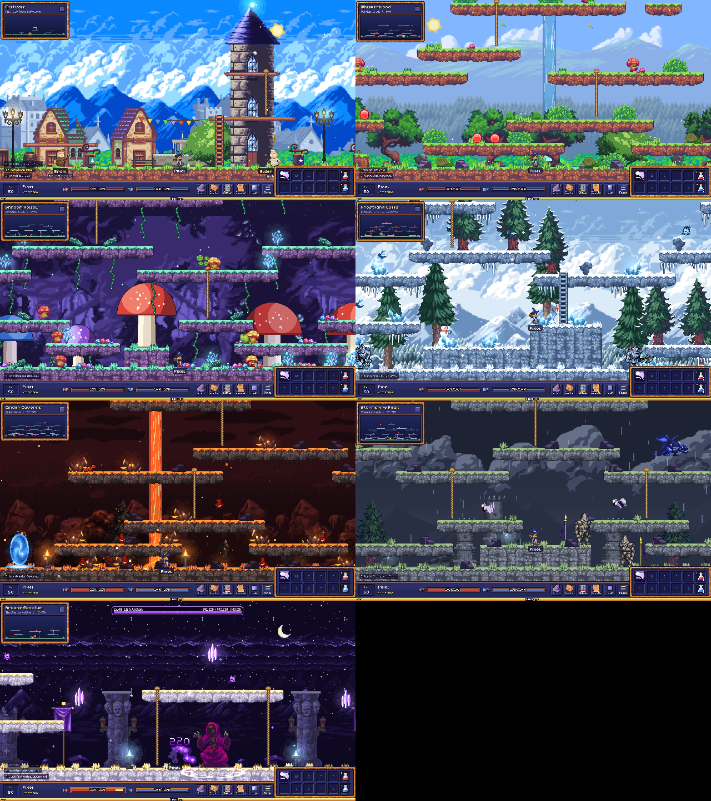

# The Academy

**[Play in your browser](https://minormending.github.io/the-academy/)** · [Student Handbook](https://minormending.github.io/the-academy/guide.html) · [Developer Docs](https://minormending.github.io/the-academy/devdocs.html)



A MapleStory-style 2D side-scroller where every student is a mage. Enrol as a Year 1 Apprentice, declare one of
five Schools of magic at level 10, pass your Year-end Exams, and graduate by defeating the Lich Archon in your
Final Thesis.

- **Five Schools, 174 spells** — Fire, Ice, Lightning, Holy and Shadow, 32 spells each across Years 2–4 (two
  ultimates per School), plus a 14-spell Year 1 core curriculum. Beyond bolts and blasts there are traps and wards
  that wait for a foe to step on them, combo payoffs that cash in a status you applied first (burn, chill, shock,
  stun, poison, curse), HP-for-MP trades, dashes that cut damage along the path you travel, and channelled beams.
  You can't max everything, so builds are choices (each School has suggested builds in the handbook); a Tome of
  Unlearning lets you respec a Year.
- **Seven zones** from the Academy grounds to the Forbidden Wing, plus three optional branch zones (the Moonlit
  Marsh, the Glacier Grotto and the Restricted Stacks), with five rare field bosses, Field Bounties,
  and the Lich Archon.
- **Main questline**, orientation for new students, side assignments and Year-end Exams.
- **Trial Hall** wave arena with Academy Merits and a Merit Exchange.
- **Academy Honors** — 60 achievements in six categories that pay Merits and unlock titles for your name tag.
- **Pip the owl familiar** auto-loots, two hotbar pages, six save slots with Character Select, full key
  rebinding, gamepad support and on-screen touch controls for phones and tablets (Settings → Touch).
- **16-bit pixel art** from freely licensed packs (see [CREDITS.md](CREDITS.md)); all music and sound are
  synthesized live in the browser.

## Play

Requires Node 18+.

```bash
npm install
```

```bash
npm run dev
```

Open http://localhost:5199 (the handbook is at `/guide.html`, the developer docs at `/devdocs.html`).
To build a static release into `dist/`:

```bash
npm run build
```

### Controls (defaults — rebind in Esc → Controls)

| Action | Keys | Gamepad |
|---|---|---|
| Move / climb | Arrow keys | D-pad / left stick |
| Jump (Down + Jump drops through platforms) | Space or Alt | A |
| Cast hotbar spells | Q W E R T · A S D F G · 1 2 | X Y LB RB LT RT, right stick · Back+X / Back+Y for 1 / 2 |
| Flip hotbar page | Tab | Back (tap) |
| Pick up loot | Z (hold) | B |
| Talk / use portal | Up | D-pad up |
| Spellbook · Inventory · Character · Assignments · Academy Honors · Minimap · Help | K · I · P · J · O · M · H | L3 / R3 for Spellbook / Inventory |
| Menu / close window | Esc | Start |

## Development

- TypeScript + Phaser 3.90 (Arcade physics) + Vite; DOM UI overlaid on the canvas.
- `npx tsc --noEmit` typechecks; `npm test` runs the Vitest data-integrity suite (skills, VFX keys, cross-references,
  graduation paths, saves, bindings); `?debug=1` shows physics bodies.
- Debug console: `arcana.levelTo(30)`, `arcana.job('pyromancer')`, `arcana.give('red_potion', 10)`,
  `arcana.warp('cinder_caverns')`, `arcana.pet()`, `arcana.s` (all services).
- Every push to `main` deploys the game, handbook and developer docs to GitHub Pages
  (`.github/workflows/pages.yml`). [docs/GUIDE.md](docs/GUIDE.md) and [docs/DEVDOCS.md](docs/DEVDOCS.md) explain how
  the two documentation pages are built from the game's own data.
- [ARCHITECTURE.md](ARCHITECTURE.md) documents the contracts, module ownership and every phase of the build;
  [ROADMAP.md](ROADMAP.md) tracks what's left.

This game was built by a team of AI agents (Claude subagents and Codex) directed by a lead Claude session.
